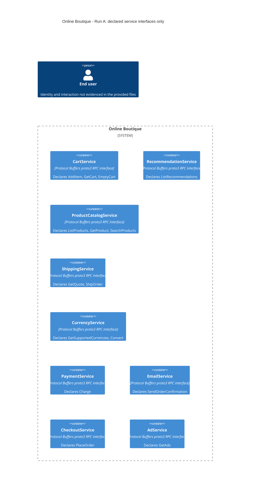

# Run A: Recovered architecture

## Agent

OpenAI Codex (GPT-6; exact model variant unavailable).

## Files read

- `AGENTS.md`
- `prompts/1-recover-architecture.md`
- `system/online-boutique/protos/demo.proto`

## Containers table

The evidence declares nine service interfaces. The entries below represent those interfaces at container level; separate processes, deployment boundaries, and implementations are **Not evidenced in the provided files**. Responsibilities describe declared operations, not verified runtime behavior.

All entries use Protocol Buffers `proto3` interface definitions (`system/online-boutique/protos/demo.proto:15`). Implementation languages and runtime transports are **Not evidenced in the provided files**. The `go_package` option (line 19) specifies a package for generated Go bindings; it does not establish service implementation languages.

| Name | Technology/language | Responsibility | Evidence (file path and symbol) |
| --- | --- | --- | --- |
| CartService | Protocol Buffers proto3 RPC interface; implementation unknown | Declares adding items, retrieving a user's cart, and emptying it. | `system/online-boutique/protos/demo.proto:23`, `CartService.AddItem`, `GetCart`, `EmptyCart` |
| RecommendationService | Protocol Buffers proto3 RPC interface; implementation unknown | Declares listing recommended product IDs for a user and supplied product IDs. | `system/online-boutique/protos/demo.proto:56`, `RecommendationService.ListRecommendations`; request/response messages, lines 60–67 |
| ProductCatalogService | Protocol Buffers proto3 RPC interface; implementation unknown | Declares listing products, retrieving a product, and searching products. | `system/online-boutique/protos/demo.proto:71`, `ProductCatalogService.ListProducts`, `GetProduct`, `SearchProducts` |
| ShippingService | Protocol Buffers proto3 RPC interface; implementation unknown | Declares requesting a shipping quote and shipping an order, returning cost or a tracking ID. | `system/online-boutique/protos/demo.proto:107`, `ShippingService.GetQuote`, `ShipOrder`; response messages, lines 117–128 |
| CurrencyService | Protocol Buffers proto3 RPC interface; implementation unknown | Declares listing supported currencies and converting monetary amounts. | `system/online-boutique/protos/demo.proto:140`, `CurrencyService.GetSupportedCurrencies`, `Convert` |
| PaymentService | Protocol Buffers proto3 RPC interface; implementation unknown | Declares charging an amount using credit card information and returning a transaction ID. | `system/online-boutique/protos/demo.proto:177`, `PaymentService.Charge`; request/response messages, lines 188–195 |
| EmailService | Protocol Buffers proto3 RPC interface; implementation unknown | Declares sending an order confirmation using an email address and order result. | `system/online-boutique/protos/demo.proto:199`, `EmailService.SendOrderConfirmation`; request message, lines 216–219 |
| CheckoutService | Protocol Buffers proto3 RPC interface; implementation unknown | Declares placing an order using user, currency, address, email, and credit card fields, returning an order result. | `system/online-boutique/protos/demo.proto:224`, `CheckoutService.PlaceOrder`; request/response messages, lines 228–239 |
| AdService | Protocol Buffers proto3 RPC interface; implementation unknown | Declares retrieving advertisements using page context keywords. | `system/online-boutique/protos/demo.proto:243`, `AdService.GetAds`; request/response messages, lines 247–254 |

No data store, message broker, frontend, or external system is declared in this file. Their existence or absence at runtime is **Not evidenced in the provided files**.

## Dependencies table

**Not evidenced in the provided files.** No caller → callee runtime dependency can be established from the service declarations. The table therefore contains no dependency rows.

| Caller → callee | Protocol | Evidence (file path and symbol) |
| --- | --- | --- |

Shared message types do not establish calls between services. For example, `PlaceOrderResponse.order` and `SendOrderConfirmationRequest.order` both use `OrderResult` (`system/online-boutique/protos/demo.proto:237` and `:216`), but this does not prove that CheckoutService calls EmailService. RPC declarations establish contracts; actual use of gRPC, endpoint addresses, call order, and failure behavior are **Not evidenced in the provided files**.

## Mermaid diagram

The nine service nodes match the containers table. There are no `Rel` entries because the dependencies table has no evidenced dependencies. The end-user placeholder follows the requested diagram format; its identity and interaction are **Not evidenced in the provided files**. The system name comes from the task; the boundary is a documentation grouping, not a verified deployment boundary.

## Gaps

Every runtime detail below is **Not evidenced in the provided files**. Suggested additional files are evidence requests only; their existence and paths have not been checked.

| Unknown | Why the proto cannot settle it | Extra file that would settle it |
| --- | --- | --- |
| Actual containers and deployment boundaries | A service declaration is an API contract, not a deployment definition. | Deployment manifest or Compose file mapping each service implementation to a running container. |
| Implementation languages and frameworks | `syntax = "proto3"` and `go_package` describe the schema and generated bindings (`system/online-boutique/protos/demo.proto:15–19`). | Each service's implementation entry point and build/dependency file. |
| Runtime callers, endpoints, and protocols | No client construction, outbound invocation, or endpoint configuration appears in the evidence. | Caller source file showing client creation and RPC invocation, plus its endpoint configuration manifest. |
| Checkout orchestration and call order | `PlaceOrder` defines input/output only (`system/online-boutique/protos/demo.proto:224–239`). | Checkout implementation file containing the `PlaceOrder` handler and outbound calls. |
| User entry point, frontend, and user-facing protocol | No UI or user-to-service interaction is declared. | Frontend request-handler source file and ingress/service configuration. |
| Data stores, persistence, and ownership | `Cart`, `Product`, and `OrderResult` are message schemas, not evidence of databases (`system/online-boutique/protos/demo.proto:47–50`, `:77–87`, `:208–214`). | Storage adapter source file and backing-store deployment/configuration file. |
| External payment, shipping, email, or advertising providers | Business-facing RPC names do not establish external integrations. | Provider adapter source file showing external client calls and its endpoint configuration. |
| Messaging, reliability, and security | No broker configuration, timeout/retry policy, authentication, or transport security configuration is provided. | Messaging client/setup file, RPC client/server initialization file, and applicable deployment configuration. |
