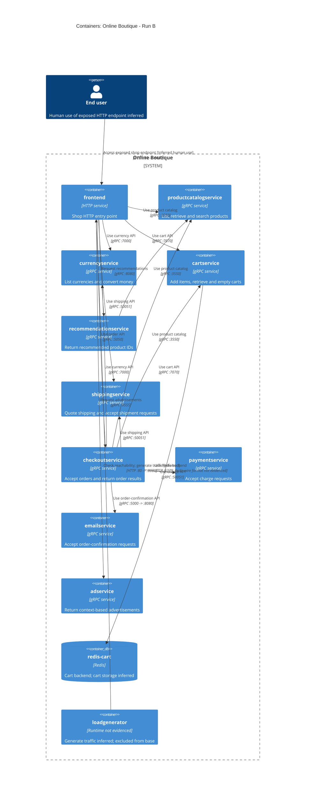

# Agent

Codex, based on GPT-6. Run: **B**.

# Files read

- `AGENTS.md`
- `prompts/1-recover-architecture.md`
- `system/online-boutique/protos/demo.proto`
- `system/online-boutique/kubernetes-manifests/README.md`
- `system/online-boutique/kubernetes-manifests/adservice.yaml`
- `system/online-boutique/kubernetes-manifests/cartservice.yaml`
- `system/online-boutique/kubernetes-manifests/checkoutservice.yaml`
- `system/online-boutique/kubernetes-manifests/currencyservice.yaml`
- `system/online-boutique/kubernetes-manifests/emailservice.yaml`
- `system/online-boutique/kubernetes-manifests/frontend.yaml`
- `system/online-boutique/kubernetes-manifests/kustomization.yaml`
- `system/online-boutique/kubernetes-manifests/loadgenerator.yaml`
- `system/online-boutique/kubernetes-manifests/paymentservice.yaml`
- `system/online-boutique/kubernetes-manifests/productcatalogservice.yaml`
- `system/online-boutique/kubernetes-manifests/recommendationservice.yaml`
- `system/online-boutique/kubernetes-manifests/shippingservice.yaml`

# Containers table

Scope: declared application services and data stores in the supplied manifests, including the separately declared loadgenerator. Kubernetes Services expose these containers; they are not additional C4 containers. The frontend-check init container is a startup helper within loadgenerator, not a separate service (`system/online-boutique/kubernetes-manifests/loadgenerator.yaml:40-70`). Application implementation languages: **Not evidenced in the provided files**.

| Name | Technology/language | Responsibility | Evidence (repository-relative path and lines/symbols) |
| --- | --- | --- | --- |
| `frontend` | HTTP service; language not evidenced | Serves the shop HTTP entry point | `system/online-boutique/kubernetes-manifests/frontend.yaml:18,47-84,109-136` |
| `productcatalogservice` | gRPC service; language not evidenced | Lists, retrieves and searches products | `system/online-boutique/kubernetes-manifests/productcatalogservice.yaml:18,46,79-81`; `system/online-boutique/protos/demo.proto:71-75 (ProductCatalogService)` |
| `currencyservice` | gRPC service; language not evidenced | Lists supported currencies and converts money | `system/online-boutique/kubernetes-manifests/currencyservice.yaml:18,46,80-82`; `system/online-boutique/protos/demo.proto:140-143 (CurrencyService)` |
| `cartservice` | gRPC service; language not evidenced | Adds cart items, retrieves carts and empties carts | `system/online-boutique/kubernetes-manifests/cartservice.yaml:18,46,50-51,80-82`; `system/online-boutique/protos/demo.proto:23-27 (CartService)` |
| `recommendationservice` | gRPC service; language not evidenced | Returns recommended product IDs | `system/online-boutique/kubernetes-manifests/recommendationservice.yaml:18,46,60-61,83-85`; `system/online-boutique/protos/demo.proto:56-67 (RecommendationService)` |
| `shippingservice` | gRPC service; language not evidenced | Quotes shipping and accepts shipment requests returning tracking IDs | `system/online-boutique/kubernetes-manifests/shippingservice.yaml:18,45,79-81`; `system/online-boutique/protos/demo.proto:107-128 (ShippingService)` |
| `checkoutservice` | gRPC service; language not evidenced | Accepts orders and returns order results; has six configured backend dependencies | `system/online-boutique/kubernetes-manifests/checkoutservice.yaml:18,45,57-68,88-90`; `system/online-boutique/protos/demo.proto:224-238 (CheckoutService)` |
| `paymentservice` | gRPC service; language not evidenced | Accepts charge requests and returns transaction IDs | `system/online-boutique/kubernetes-manifests/paymentservice.yaml:18,46,79-81`; `system/online-boutique/protos/demo.proto:177-195 (PaymentService)` |
| `emailservice` | gRPC service; language not evidenced | Accepts order-confirmation email requests | `system/online-boutique/kubernetes-manifests/emailservice.yaml:18,46,81-83`; `system/online-boutique/protos/demo.proto:199-218 (EmailService)` |
| `adservice` | gRPC service; language not evidenced | Returns advertisements for supplied context keys | `system/online-boutique/kubernetes-manifests/adservice.yaml:18,46,81-83`; `system/online-boutique/protos/demo.proto:243-261 (AdService)` |
| `redis-cart` | Redis (redis:alpine) | Redis endpoint used by cartservice; [Inferred] stores cart data | `system/online-boutique/kubernetes-manifests/cartservice.yaml:50-51,92,110-120,129-141,146-156` |
| `loadgenerator` | Container image loadgenerator; language/framework not evidenced | [Inferred] generates shop traffic; explicitly checks frontend reachability during initialization; separately declared, excluded from base Kustomization | `system/online-boutique/kubernetes-manifests/loadgenerator.yaml:17,40-70,80-87`; `system/online-boutique/kubernetes-manifests/kustomization.yaml:24` |

# Dependencies table

These are configured runtime links, not observed executions. Caller environment variables identify targets; the target Service port name and proto contract support gRPC. Relationship labels describe the target API, not a verified caller-specific method sequence. The Redis edge records TCP only because the supplied manifest does not identify its wire format. The human actor and traffic-generation behavior are explicitly [Inferred].

| Caller → callee | Protocol / Service port | Relationship | Evidence (repository-relative path and symbol) |
| --- | --- | --- | --- |
| `End user` → `frontend` | HTTP :80 -> :8080 | Access exposed shop endpoint [Inferred human use] | `system/online-boutique/kubernetes-manifests/frontend.yaml:124-136 (frontend-external, type: LoadBalancer, port name http, selector app: frontend). Human use is [Inferred]; no browser code was provided.` |
| `frontend` → `productcatalogservice` | gRPC :3550 | Use product catalog | `system/online-boutique/kubernetes-manifests/frontend.yaml:69-70 (PRODUCT_CATALOG_SERVICE_ADDR=productcatalogservice:3550); system/online-boutique/kubernetes-manifests/productcatalogservice.yaml:79-81 (grpc); system/online-boutique/protos/demo.proto:71-75 (ProductCatalogService).` |
| `frontend` → `currencyservice` | gRPC :7000 | Use currency API | `system/online-boutique/kubernetes-manifests/frontend.yaml:71-72 (CURRENCY_SERVICE_ADDR=currencyservice:7000); system/online-boutique/kubernetes-manifests/currencyservice.yaml:80-82 (grpc); system/online-boutique/protos/demo.proto:140-143 (CurrencyService).` |
| `frontend` → `cartservice` | gRPC :7070 | Use cart API | `system/online-boutique/kubernetes-manifests/frontend.yaml:73-74 (CART_SERVICE_ADDR=cartservice:7070); system/online-boutique/kubernetes-manifests/cartservice.yaml:80-82 (grpc); system/online-boutique/protos/demo.proto:23-27 (CartService).` |
| `frontend` → `recommendationservice` | gRPC :8080 | Request recommendations | `system/online-boutique/kubernetes-manifests/frontend.yaml:75-76 (RECOMMENDATION_SERVICE_ADDR=recommendationservice:8080); system/online-boutique/kubernetes-manifests/recommendationservice.yaml:83-85 (grpc); system/online-boutique/protos/demo.proto:56-58 (RecommendationService).` |
| `frontend` → `shippingservice` | gRPC :50051 | Use shipping API | `system/online-boutique/kubernetes-manifests/frontend.yaml:77-78 (SHIPPING_SERVICE_ADDR=shippingservice:50051); system/online-boutique/kubernetes-manifests/shippingservice.yaml:79-81 (grpc); system/online-boutique/protos/demo.proto:107-110 (ShippingService).` |
| `frontend` → `checkoutservice` | gRPC :5050 | Use order API | `system/online-boutique/kubernetes-manifests/frontend.yaml:79-80 (CHECKOUT_SERVICE_ADDR=checkoutservice:5050); system/online-boutique/kubernetes-manifests/checkoutservice.yaml:88-90 (grpc); system/online-boutique/protos/demo.proto:224-226 (CheckoutService).` |
| `frontend` → `adservice` | gRPC :9555 | Request advertisements | `system/online-boutique/kubernetes-manifests/frontend.yaml:81-82 (AD_SERVICE_ADDR=adservice:9555); system/online-boutique/kubernetes-manifests/adservice.yaml:81-83 (grpc); system/online-boutique/protos/demo.proto:243-245 (AdService).` |
| `checkoutservice` → `productcatalogservice` | gRPC :3550 | Use product catalog | `system/online-boutique/kubernetes-manifests/checkoutservice.yaml:57-58 (PRODUCT_CATALOG_SERVICE_ADDR=productcatalogservice:3550); system/online-boutique/kubernetes-manifests/productcatalogservice.yaml:79-81 (grpc); system/online-boutique/protos/demo.proto:71-75 (ProductCatalogService).` |
| `checkoutservice` → `shippingservice` | gRPC :50051 | Use shipping API | `system/online-boutique/kubernetes-manifests/checkoutservice.yaml:59-60 (SHIPPING_SERVICE_ADDR=shippingservice:50051); system/online-boutique/kubernetes-manifests/shippingservice.yaml:79-81 (grpc); system/online-boutique/protos/demo.proto:107-110 (ShippingService).` |
| `checkoutservice` → `paymentservice` | gRPC :50051 | Use charge API | `system/online-boutique/kubernetes-manifests/checkoutservice.yaml:61-62 (PAYMENT_SERVICE_ADDR=paymentservice:50051); system/online-boutique/kubernetes-manifests/paymentservice.yaml:79-81 (grpc); system/online-boutique/protos/demo.proto:177-179 (PaymentService).` |
| `checkoutservice` → `emailservice` | gRPC :5000 -> :8080 | Use order-confirmation API | `system/online-boutique/kubernetes-manifests/checkoutservice.yaml:63-64 (EMAIL_SERVICE_ADDR=emailservice:5000); system/online-boutique/kubernetes-manifests/emailservice.yaml:81-83 (grpc, port 5000, targetPort 8080); system/online-boutique/protos/demo.proto:199-201 (EmailService).` |
| `checkoutservice` → `currencyservice` | gRPC :7000 | Use currency API | `system/online-boutique/kubernetes-manifests/checkoutservice.yaml:65-66 (CURRENCY_SERVICE_ADDR=currencyservice:7000); system/online-boutique/kubernetes-manifests/currencyservice.yaml:80-82 (grpc); system/online-boutique/protos/demo.proto:140-143 (CurrencyService).` |
| `checkoutservice` → `cartservice` | gRPC :7070 | Use cart API | `system/online-boutique/kubernetes-manifests/checkoutservice.yaml:67-68 (CART_SERVICE_ADDR=cartservice:7070); system/online-boutique/kubernetes-manifests/cartservice.yaml:80-82 (grpc); system/online-boutique/protos/demo.proto:23-27 (CartService).` |
| `recommendationservice` → `productcatalogservice` | gRPC :3550 | Use product catalog | `system/online-boutique/kubernetes-manifests/recommendationservice.yaml:60-61 (PRODUCT_CATALOG_SERVICE_ADDR=productcatalogservice:3550); system/online-boutique/kubernetes-manifests/productcatalogservice.yaml:79-81 (grpc); system/online-boutique/protos/demo.proto:71-75 (ProductCatalogService).` |
| `cartservice` → `redis-cart` | TCP :6379; Redis wire format not evidenced | Use Redis backend | `system/online-boutique/kubernetes-manifests/cartservice.yaml:50-51 (REDIS_ADDR=redis-cart:6379), 118-120 (redis:alpine), 153-156 (tcp-redis).` |
| `loadgenerator` → `frontend` | HTTP :80 -> :8080 | Check reachability; generate traffic [Inferred] | `system/online-boutique/kubernetes-manifests/loadgenerator.yaml:49 (wget http://${FRONTEND_ADDR}), 69-70 and 82-83 (FRONTEND_ADDR=frontend:80), 84-87 (USERS, RATE); system/online-boutique/kubernetes-manifests/frontend.yaml:119-121 (http). Excluded from base: system/online-boutique/kubernetes-manifests/kustomization.yaml:24.` |

# Mermaid diagram

The diagram contains exactly the 12 containers and 17 relationships in the tables, plus the required end-user actor. No external provider is evidenced. Protocol arrows show Service port → targetPort where these differ.

# Gaps

The extra paths below are proposed evidence to inspect next; they were not opened, and their existence was not verified.

| Gap | What the supplied evidence establishes or leaves unknown | Extra file/evidence that would settle it |
| --- | --- | --- |
| Application languages and frameworks | Not evidenced in the provided files. Image names, gRPC contracts and go_package do not establish each implementation language. | Candidate `system/online-boutique/src/<service>/Dockerfile` and its referenced project/dependency file. |
| Actual call sites and order-processing workflow | Not evidenced in the provided files. Address configuration shows intended wiring; RPC contracts show available operations, not which caller invokes each method, execution order, retries or transactions. | Candidates `system/online-boutique/src/frontend/main.go`, `system/online-boutique/src/checkoutservice/main.go` and `system/online-boutique/src/recommendationservice/recommendation_server.py`. |
| Shopping assistant runtime inclusion and protocol | `system/online-boutique/kubernetes-manifests/frontend.yaml:83-84` sets SHOPPING_ASSISTANT_SERVICE_ADDR=shoppingassistantservice:80, but ENABLE_ASSISTANT is commented out at lines 93-94 and the shopping-assistant component is commented out in `system/online-boutique/kubernetes-manifests/kustomization.yaml:35`. No matching Deployment, Service or proto contract is provided. An active runtime dependency and protocol are Not evidenced in the provided files; port 80 alone is insufficient. Omitted from the tables and diagram pending confirmation. | Candidates `system/online-boutique/kustomize/components/shopping-assistant/kustomization.yaml`, the manifest it references, and `system/online-boutique/src/frontend/main.go`. |
| Load-generator activation and workload | Its Deployment and HTTP startup check are evidenced, so it is included as a separately declared container. It is excluded from base resources in `system/online-boutique/kubernetes-manifests/kustomization.yaml:24`; that comment mentions a Skaffold module. Actual deployment and traffic behavior are Not evidenced in the provided files. | Candidates `system/online-boutique/skaffold.yaml` and `system/online-boutique/src/loadgenerator/locustfile.py`. |
| Redis data model and durability guarantees | The cart address and Redis image are evidenced. Cart storage is [Inferred]. `system/online-boutique/kubernetes-manifests/cartservice.yaml:129-141` mounts /data from emptyDir; no persistent volume is declared there. Redis commands, persistence settings and recovery guarantees are Not evidenced in the provided files. | Candidate `system/online-boutique/src/cartservice/src/cartstore/RedisCartStore.cs` and the final rendered Redis Deployment/configuration. |
| External providers, additional stores or brokers | Not evidenced in the provided files. Payment, email and shipping RPC names do not prove real provider integrations; none are drawn. The commented PACKAGING_SERVICE_URL at `system/online-boutique/kubernetes-manifests/frontend.yaml:97-99` does not establish a runtime dependency. Istio probe-rewrite annotations in `system/online-boutique/kubernetes-manifests/frontend.yaml:29-30` and `system/online-boutique/kubernetes-manifests/loadgenerator.yaml:29-30` do not establish an injected proxy or mesh. | Candidates `system/online-boutique/src/paymentservice/charge.js`, `system/online-boutique/src/emailservice/email_server.py`, `system/online-boutique/src/shippingservice/main.go` and final rendered workload manifests. |
| User journeys, transport security and live topology | The external frontend Service and HTTP ports are evidenced; human use is [Inferred]. Detailed UI journeys, HTTPS termination, backend TLS/authentication, live replicas and successful deployment are Not evidenced in the provided files. `system/online-boutique/kubernetes-manifests/README.md:3-8` says these manifests require image-tag insertion and are not directly deployable. | Candidate `system/online-boutique/src/frontend/main.go`, deployment overlays/Ingress or Gateway configuration, and a rendered/deployed manifest snapshot. |
